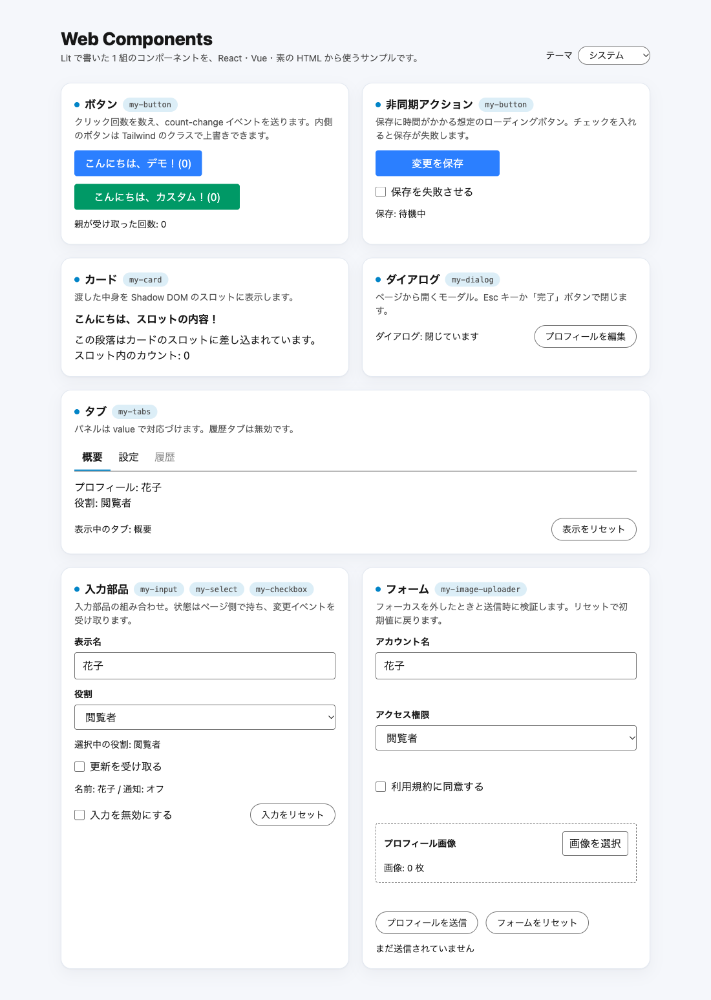

# web-components

[Lit](https://lit.dev/) で書いた Web Components を、**React・Vue・フレームワークなしの HTML** から同じように使える工夫をしました。



* **実体は 1 本**: Web Component は Lit で 1 つだけ書き、React / Vue 用に作り直さない
* **型が効く**: props もカスタムイベントの `detail` も TypeScript で補完される
* **Tailwind などの CSS ライブラリを使える**: Web Components の要素は通常の HTML 要素と同じなので、ページの CSS をそのまま適用できる（ただし Shadow DOM の内側は隔離される）。例として Tailwind を採用している（必須ではない。後述）
* **SPA と SSR の両方で動く**: React Router と Nuxt の標準構成のまま、hydration まで E2E で確認している
* **Storybook で確認できる**: 全コンポーネントを、フレームワークなしの実体のまま表示できる
* **テストできる**: コンポーネントは vitest、画面は Playwright（5 サイト共通の spec）で確認している
* **フォームライブラリと組み合わせられる**: React Hook Form / vee-validate の連携例がある（[docs/components.md](docs/components.md)）

普通の React / Vue のコンポーネントと同じ流れ（型・スタイル・Storybook・テスト・SSR・フォーム）で扱えることを示すサンプルです。
ただし違いもあります。Shadow DOM のコンポーネントには外の CSS（Tailwind を含む）が届かず、SSR で出力されるのはホストタグと slot の内容だけで、中身はブラウザで描画されます（Lit SSR は未導入）。

## クイックスタート

[Bun](https://bun.sh/) 1.4.2 以降、Node.js 24.21.0 以降

```sh
bun install
bun run dev:react   # React（SPA）
bun run dev:vue     # Vue / Nuxt（SPA）
bun run dev:react:ssr   # React（SSR）
bun run dev:vue:ssr     # Vue / Nuxt（SSR）
bun run dev:native  # フレームワークなし

```
全サイトで共通のデザインになっています。

## 構成

```
packages/ui/            @web-components/ui
  src/web-components/   Lit の実体（button / card / checkbox / dialog /
                        image-uploader / input / select / tabs）
  src/react/            React の薄いラッパー
  src/vue/              Vue の薄いラッパー
apps/react/             React Router（Framework Mode）のデモ
apps/vue/               Nuxt のデモ
apps/native/            フレームワークなしのデモ
e2e/                    Playwright（5 サイト共通）
docs/                   詳細ドキュメント
```

ラッパーはロジックを持たず、WebComponentsの `static` 情報（タグ名・イベント名）から props とイベント型を作ります。

## 使い方

### React

```tsx
import { MyButton, MyCard } from "@web-components/ui/react";

<MyButton name="Ada" onCountChange={(e) => console.log(e.detail.count)} />
<MyCard label="Notes"><p>slot に入る</p></MyCard>
```

import した時点で custom element が登録されます。イベントは `onCountChange` のように
prop へ配線され、`e.detail.count` まで型が付きます。

### Vue

```vue
<script setup lang="ts">
import { MyButton, MyCard } from "@web-components/ui/vue";
</script>

<template>
  <MyButton name="Ada" @count-change="(detail) => console.log(detail.count)" />
  <MyCard label="Notes"><p>slot に入る</p></MyCard>
</template>
```

`isCustomElement` の設定は不要です。イベントの payload は `CustomEvent` ではなく `detail` が渡されます（React との違い）。

### フレームワークなし

```ts
import "@web-components/ui";

const button = document.createElement("my-button");
button.name = "Native";
button.addEventListener("count-change", (event) => {
  console.log((event as CustomEvent<{ count: number }>).detail.count);
});
document.body.append(button);
```

React / Vue を乗り換えても、要素・props・イベントの契約はそのまま使えます。

### スタイルの上書きと Tailwind

Web Components の要素は通常の HTML 要素と同じなので、ページの CSS（Tailwind などの CSS ライブラリを含む）をそのまま適用できます。
ただし、Shadow DOM の内側だけは、ブラウザの仕様どおり外の CSS から隔離されます。

`my-button` だけは **Shadow DOM をオフ**（light DOM）にしています。ホストアプリの Tailwind のクラスを
ボタンの中まで効かせるためです。そのため、スタイルの隔離と `<slot>` はありません。

```tsx
<MyButton className="w-64" buttonClass="w-full bg-emerald-600 hover:bg-emerald-700" />
```

`className` はホスト要素（レイアウト向け）、`buttonClass` は内側の `<button>` に届き、
`tailwind-merge` で既定のクラスより優先されます。

それ以外のコンポーネントは Shadow DOM のままで、Tailwind を含む外の CSS は内側に届きません（Tailwind 固有ではなく、Shadow DOM の性質です）。
`::part()` と `--my-*` カスタムプロパティで変更します。詳細は [docs/components.md](docs/components.md)。

#### Tailwind を使うときの `@source`

通常の React / Vue のコンポーネントと違い、**ライブラリ側のソースを Tailwind に教える設定が要ります。**
Tailwind v4 はソースを自動検出しますが、`.gitignore` に載っているファイルと `node_modules` は走査しません。
`my-button` のクラス（`bg-blue-500` など）は `packages/ui` のソースの中にあるので、走査対象に入っていないと、そのクラスの CSS が生成されません。

このリポジトリでは、共通 CSS の [apps/demo.css](apps/demo.css) で `packages/ui` を登録しています（React / Vue / native / Storybook がすべてこの CSS を読み込みます）。

```css
@import "tailwindcss";
@source "../packages/ui"; /* stylesheet からの相対パス */
```

自分のアプリへ持っていくときは、`packages/ui` の場所に合わせてパスを変えてください。
`@source` を足すのは、Tailwind を使う場合の `my-button` のためだけです。Shadow DOM のコンポーネントは自分の CSS を持つので関係ありません。

#### Tailwind を使わない場合

**Tailwind は必須ではありません。** CSS ライブラリを使う例として採用しただけで、
Shadow DOM のコンポーネントは Tailwind なしで動きます。`my-button` も、既定の見た目が Tailwind のクラスで書かれているだけなので、
使わない場合は `my-button button { … }` や `buttonClass` に自分の CSS のクラスを渡して見た目を決めます。

## コンポーネント

| 要素 | 用途 | 主な props | イベント |
| --- | --- | --- | --- |
| `my-button` | ボタン（light DOM） | `name` `label` `loading` `disabled` `buttonClass` | `count-change` |
| `my-card` | スロット付きカード | `label` | — |
| `my-input` | 文字列入力 | `label` `value` `placeholder` `disabled` `error` | `value-change` |
| `my-checkbox` | 真偽値入力 | `label` `checked` `disabled` `error` | `checked-change` |
| `my-select` | 選択欄 | `label` `value` `options` `placeholder` `disabled` `error` | `value-change` |
| `my-dialog` | モーダル | `label` `open` | `open-change` |
| `my-tabs` | タブ | `label` `value` `items` | `value-change` |
| `my-image-uploader` | 画像選択（通信なし） | `label` `files` `allowedTypes` `maxFiles` `maxBytes` `disabled` `error` | `files-change` `files-reject` |

props・イベントの詳細、フォームライブラリとの連携、SSR の注意点は [docs/components.md](docs/components.md) にあります。

## ドキュメント

* [docs/components.md](docs/components.md) — コンポーネントの仕様、スタイル、フォーム連携、SSR、テーマ
* [docs/design-notes.md](docs/design-notes.md) — デコレータを使わない理由、ラッパーの共通化、`#` subpath imports など
* [docs/development.md](docs/development.md) — コマンド、E2E、Storybook、本番ビルドの確認

## Storybook

```sh
bun run --filter @web-components/ui storybook   # http://localhost:6006/
```

Button・Card・Input・Checkbox・Select・Dialog・Tabs・Image Uploader を、React・Vue を通さず実体のまま表示します。
Controls で props を変えられ、ツールバーの Theme でライト / ダーク / システムを切り替えられます。

## 開発

```sh
bun run build        # 全パッケージのビルド（型チェック込み）
bun run lint         # Biome
bun run test:e2e     # Playwright（5 サイトを自動起動。初回は bunx playwright install chromium）
```

`CLAUDE.md` と `.claude/`、`.mcp.json` は Claude Code でこのリポジトリを触るときの設定です。使わなくても開発に影響しません。

## Web Components のメリットとデメリット

### メリット

* **ロジックが 1 本で済む**: React・Vue・フレームワークなしで同じ要素を使える。フレームワークを乗り換えても、混在していても、要素・props・イベントの契約は変わらない。なお、型補完まで揃えるなら React / Vue 用の薄いラッパーを足すことになる（このサンプルはそうしている。ラッパーなしでも使える。下記）
* **ブラウザ標準が土台**: フレームワークのバージョンアップに引きずられにくい
* **スタイルを隔離できる**: Shadow DOM のコンポーネントは、ホストの CSS と衝突しない
* **公開する窓口が決まっている**: props・イベント・slot・`::part()`・CSS カスタムプロパティだけが外から触れる部分になる
* **フレームワークのない場所にも置ける**: CMS や静的な HTML など、React / Vue を使えない環境でも動く

### デメリット

* **外のスタイルが届かない**: Shadow DOM の内側には、Tailwind を含むどの CSS も届かず、`::part()` と CSS 変数で上書きする
* **SSR は別の仕組みが要る**: Shadow DOM はブラウザの API なので、React / Vue の標準の SSR では内側が出力されず、JavaScript が動くまで空になる。サーバーで出すには Declarative Shadow DOM や Lit SSR のような仕組みを足す必要がある
* **フォームに自動で参加しない**: Shadow DOM 内の入力は `<form>` から見えないので、`FormData` やネイティブの検証・reset と連携するには、form-associated custom elements にするか light DOM にする必要がある。このサンプルは、値と検証を React Hook Form などの呼び出し側が持つ前提のため、対応していない
* **ID 参照が境界をまたげない**: `label for` や `aria-labelledby` を Shadow DOM の外と内でつなげない

SSR について補足します。Web Components は SPA にはそのまま使えます。SSR と SG（静的生成）では、ホスト要素と slot の内容は出力されますが、Shadow DOM の内側は JavaScript が動いてからの描画です（SG もビルド時の HTML に内側が入らない点は同じ）。
ボタン・入力・ダイアログのような操作する部品では、これは大きな問題になりません。ページの主要な内容を部品の内側に持たせず、slot（外側の DOM）に置けば、SSR のサイトでも使えます。このサンプルの SSR サイトは、その状態で hydration まで動くことを確認するためのものです。

ラッパーは必須ではありません。React 19 は、カスタム要素へ props をプロパティとして渡せ、`onspeak` のように `on` + イベント名でカスタムイベントを購読できます（[React 公式ドキュメント](https://react.dev/reference/react-dom/components)）。
このサンプルのラッパーは、`onCountChange` のような名前と `e.detail` の型補完のためのものです。

## 残っている課題

* **Shadow DOM の内側にはどの CSS も届かず、light DOM にすると `<slot>` が使えない**: Tailwind 固有の問題ではなく、普通の CSS でも同じ。ホストの Tailwind を内側まで効かせるために `my-button` を light DOM にしており、light DOM には `<slot>` がない。中身を渡したい部品は Shadow DOM にするしかなく、その内側にはクラスが届かない。コンパイル済みの Tailwind CSS を各コンポーネントの Shadow DOM へ取り込めば両立できる可能性があるが、試していない

## ライセンス

[MIT](LICENSE)
